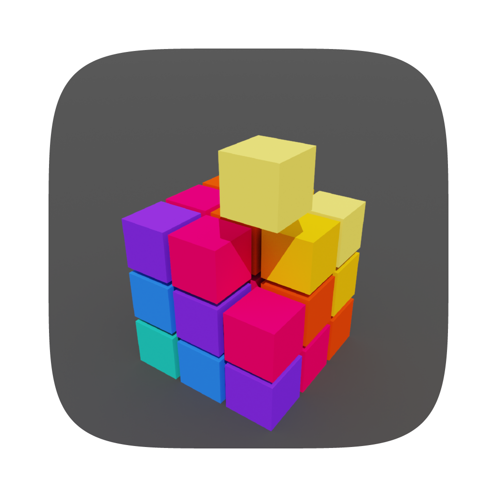
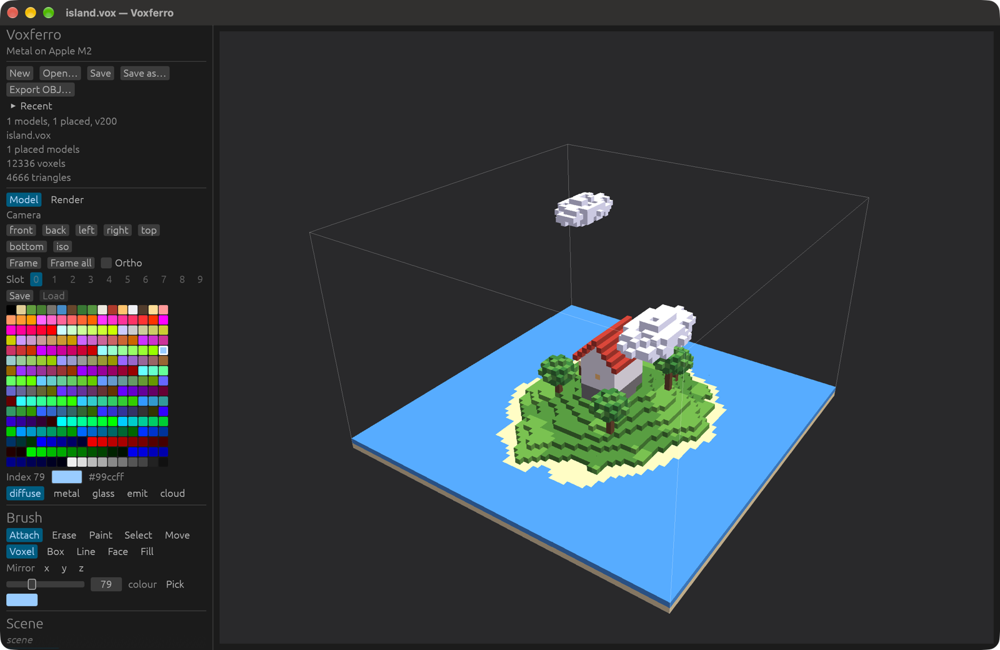

# Voxferro



A voxel editor in Rust (formerly *Voxferro*), native on Apple
Silicon, compatible with the reference editor's `.vox` format.

A learning project: the goal is to understand modern graphics and Rust by
building something real, not to clone the reference editor line by line. File
interoperability is a goal; the architecture is its own and idiomatic
Rust.

## Gallery

Everything below was made and rendered with Voxferro itself: the scenes are
lists of its console commands, the images come from its path tracer.


*A small island: terrain, trees and a house with lit windows, under the
atmospheric sky, with clouds as participating media. 12,336 voxels, built
by [`island.cmds`](assets/showcase/island.cmds) (generated by
[`scripts/showcase/island.py`](scripts/showcase/island.py)); 1,024
samples.*

| | |
|---|---|
|  |  |
| *Shapes from the GPU compute kernels: a gold metal torus, a glass shell with a glowing core and a rounded box ([`shapes.cmds`](assets/showcase/shapes.cmds)).* | *A house built by Claude through the MCP server: it chose the palette, built it in `run_commands` batches and checked its own renders ([`house.vox`](assets/showcase/house.vox)).* |



*The editor with the island open: palette, brushes, saved camera slots and
the model's box and floor grid.*

To rebuild a scene and render it yourself:

```bash
cargo run --release -p voxferro -- --script assets/showcase/island.cmds --render-mode
```

## Status

Phases 0–40 and 43 of the [ROADMAP](ROADMAP.md) are complete, with **206 tests
passing**. Working today:

- Reading **and writing** `.vox` (versions 150 and 200), validated against the
  real corpus and against `dot_vox`
- Viewer with greedy meshing (coplanar faces merged) in cached chunks:
  editing a 256³ model rebuilds only what was touched (~8 ms in release)
- Scene graph with transforms and animation frames; editing and rendering
  of scenes with multiple models, rotated ones included
- Open, new, save as, and a warning about unsaved changes
- Attach / erase / paint brushes with voxel, box, line, face and
  fill shapes, with preview and one-step undo/redo per stroke
- Selection (box, face, color), copy/cut/paste, move; rotate, mirror,
  crop and resize the model
- Editable scene: move, turn, duplicate, add and remove models; groups
  (create, move, turn, hide, dissolve, drag in the tree) and named layers with visibility, all
  saved in the file
- Palette and materials editable from the interface, with undo
- Animation: playback, transform keys (interpolated as in
  the reference editor a recent version), shape frames, range, timeline (with
  draggable keys) and export of rendered frames to PNG
- Export to OBJ + MTL + palette texture
- Camera: frame selection or scene, axis and isometric views,
  orthographic projection (also in the path tracer) and panning
- Render settings (sun, uniform / atmospheric / HDR sky, ground, lens,
  film, bloom) editable in the panel, with undo and saved in the
  file; depth of field with a polygonal aperture
- Command console
- Voxel operations as compute kernels in WGSL
- Voxel scripts (`xs`): the reference editor's GLSL scripts run unchanged, and WGSL
  ones of our own, from a Scripts panel with a slider per argument
- Atomic saving that preserves materials, cameras and renderer settings
- Progressive path tracer (GI, shadows, ACES) with the file's lighting
- Metal, glass, emissive and cloud materials (media that absorb, scatter
  or emit), with the reference editor's formulas; fog
- Infinite ground plane that blends into the horizon
- Lighting with HDR maps, oriented and normalized as in the reference editor
- Atmospheric sky with Rayleigh and Mie scattering, and a sun that reddens at sunset

Native arm64 on Metal: `[voxferro] graphics backend: Metal on Apple M2`.

## Usage

```bash
cargo run -p voxferro                                  # opens monu1.vox
cargo run -p voxferro -- assets/vox/castle.vox         # opens another model
cargo run -p voxferro -- --run "gpu torus 166 40 14 replace" --run "save out.vox"
cargo run -p voxferro -- --run "new 40" --run "xs menger 3" --run "xs -n 2 grow" --screenshot out.bmp
cargo run -p voxferro -- assets/vox/monu1.vox --render-mode           # opens in Render mode
cargo run -p voxferro -- assets/vox/monu1.vox --render 200 --screenshot out.bmp
cargo run -p voxferro -- --run "new 16" --run "brush attach box" --drag 0.3 0.7 0.6 0.8 --screenshot out.bmp
```

To let an agent use the editor over MCP (only on `127.0.0.1`, off by
default; it can also be turned on from the *Agents (MCP)* section of the panel):

```bash
cargo run -p voxferro -- --mcp                          # listens on 127.0.0.1:47800
claude mcp add --transport http voxferro http://127.0.0.1:47800/mcp
```

As a macOS application, with its icon:

```bash
./scripts/bundle-macos.sh          # creates target/Voxferro.app
open target/Voxferro.app
./scripts/make-icon.sh             # re-renders the icon
```

On Windows (built and smoke-tested in CI on a software GPU; not yet tried on
a Windows machine):

```powershell
powershell -ExecutionPolicy Bypass -File scripts\package-windows.ps1 -WithDxc   # target\dist\Voxferro-<version>-windows-x64.zip
```

Render mode on DirectX 12 needs Microsoft's DXC shader compiler
(`dxcompiler.dll` and `dxil.dll` next to `voxferro.exe`; `-WithDxc` downloads
a pinned release). Without it Voxferro uses Vulkan if the GPU driver offers
it, and otherwise says that Render mode needs DXC. `dxil.dll` comes under a
Microsoft licence with distribution requirements: read `LICENSE-MS.txt`
before sharing a package that includes it.

On Linux:

```bash
./scripts/package-linux.sh                         # target/dist/voxferro-<version>-linux-<arch>.tar.gz
tar -xzf target/dist/voxferro-*-linux-*.tar.gz -C ~/.local
```

The tarball holds `bin/` and `share/` (the `.desktop` entry, icons, the
`.vox` MIME type and the assets); with `appimagetool` on the `PATH` the
script also builds an AppImage. File dialogs use the XDG desktop portal;
without one, `open <path>` in the console always works.

**Mouse:** clicking on the model edits with the brush; clicking on empty space
(or dragging with the right button) orbits; Shift + drag or the middle
button pans; the scroll wheel zooms in.

**Option+click** on a model selects its group (again: one level further
in).

**Move tool:** dragging moves the model (or its selected group) along
the ground; Shift+drag, up and down; Cmd+drag turns around z;
X, Y, Z give a quarter turn.

**Keyboard:** I eyedropper, F frames (Shift+F everything), 1–7 fixed views, O orthographic;
Cmd+N/O/S, Cmd+Shift+S, Cmd+Z / Cmd+Shift+Z; with a selection,
Cmd+A, Esc, Delete, Cmd+C/X/V, arrow keys and Page Up/Page Down to move it.

**Console** (left panel; `help` for the model commands):

| Group | Commands |
|---|---|
| Files | `open [path]`, `new [n \| x y z]`, `save [path]`, `export <path.obj>` |
| Brush | `brush [attach\|erase\|paint\|select\|move] [voxel\|box\|line\|face\|fill]`, `color <n>` |
| Selection | `select all\|none\|invert\|color [n]`, `delete`, `paint [c]`, `copy`, `cut`, `paste`, `move dx dy dz` |
| Model | `rotate x\|y\|z`, `mirror x\|y\|z`, `crop`, `resize x y z`, `fill`, `clear`, `box`, `sphere`, `gpu …` |
| Scene | `instance list\|select i\|move dx dy dz\|place x y z\|turn\|dup\|delete\|new [x y z]` |
| Palette | `palette <i> <r> <g> <b>`, `material <i> <diffuse\|metal\|glass\|emit> [key=value]…` |
| Groups and layers | `group [i ...]\|select n`, `ungroup`, `node name\|hide\|show\|move\|turn\|into`, `layer list\|new\|hide\|show\|name\|assign` |
| Animation | `anim play\|stop\|frame n\|fps n\|key\|unkey\|newframe\|movekey a b\|moveframe a b\|range a b\|export dir [samples]` |
| Camera | `camera front\|back\|left\|right\|top\|bottom\|iso\|ortho\|persp\|frame [all\|selection\|instance]` |
| Scripts | `xs [-n passes] [-c c1,c2,…] <script> [args…]`, `xs list` |
| Render | `env uniform\|atmosphere [elev]\|ibl <map> [i] [rot]\|dof [on\|off]\|lens [aperture] [blades] [angle]\|bloom [mix] [scale] [aspect] [threshold]\|vig <v>` |

For testing without a mouse: `--click fx fy` and `--drag fx0 fy0 fx1 fy1`, in
fractions of the viewport.

## Stack

| Piece | Choice | Why |
|---|---|---|
| Window + UI | `eframe` / `egui` 0.36 | Brings wgpu by default and pins a stable `winit` |
| Graphics | `wgpu` 30 | Emits **native Metal** on Apple Silicon |
| Math | `glam` 0.34 | SIMD, the ecosystem standard |
| GPU bytes | `bytemuck` 1 | `#[derive(Pod)]` for the buffers |
| Dialogs | `rfd` 0.17 | Native open and save panels |
| PNG | `miniz_oxide` 0.9 | DEFLATE for the exported frames |

`eframe` and `wgpu` resolve to a **single** `wgpu v30.0.1` in the graph. If
two versions show up, the types stop being assignable to each other and the
errors become incomprehensible: check with `cargo tree | grep wgpu`
before touching those versions.

## Structure

```
crates/
├── vox-format/   .vox parser          — no graphics dependencies
├── voxel-core/   volume, graph, undo, brushes, selection, meshing, OBJ
│                 — no graphics dependencies
└── app/          eframe + egui + wgpu
```

The first two crates deliberately do not depend on wgpu: `cargo test -p
vox-format` runs in a second instead of recompiling the graphics stack.

### Tests

```bash
cargo test -p vox-format -p voxel-core   # fast: does not compile wgpu
cargo test                               # everything
```

## License and scope

Independent implementation. The `.vox` format is publicly documented
by its author, its author. This repository contains no the reference editor code or
assets; the test models are kept out of version control
(see `assets/README.md`).

## License

Dual-licensed, at the user's option: [MIT](LICENSE-MIT) or
[Apache 2.0](LICENSE-APACHE).

the reference editor is the work of its author. Voxferro is not affiliated with the reference editor and
does not contain its code: it reads and writes its `.vox` format. The example models and
the reference editor's environment maps are not included in the repository (see
[assets/README.md](assets/README.md)).
