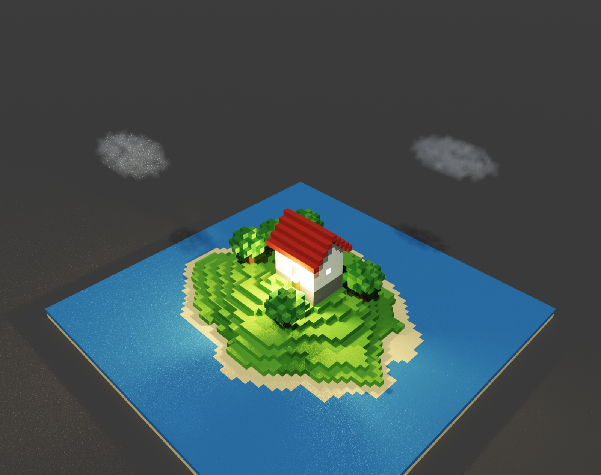
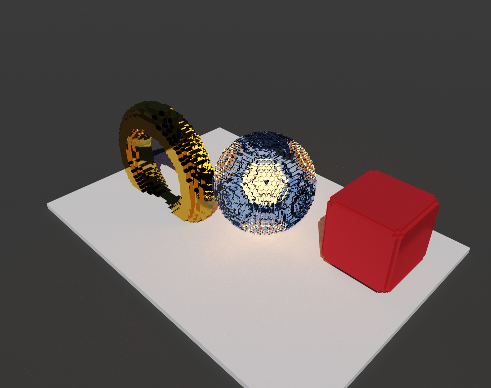
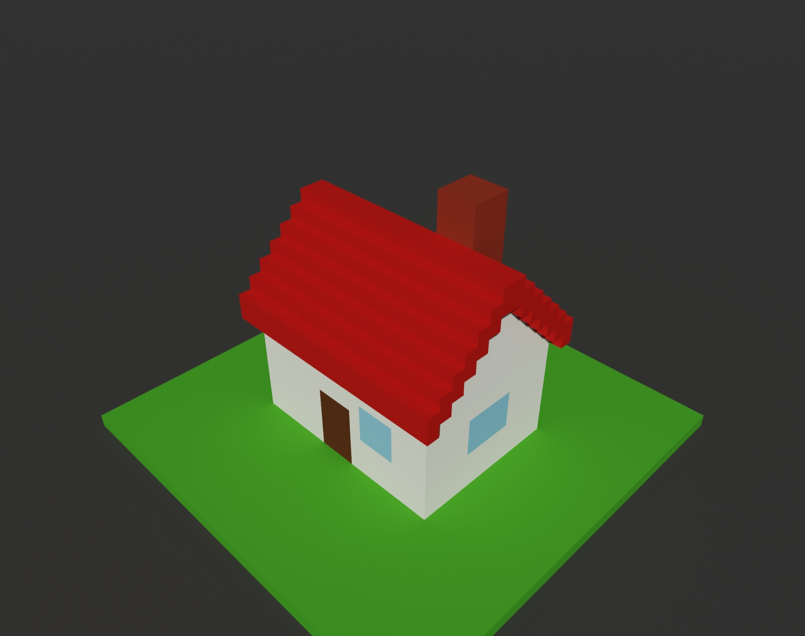
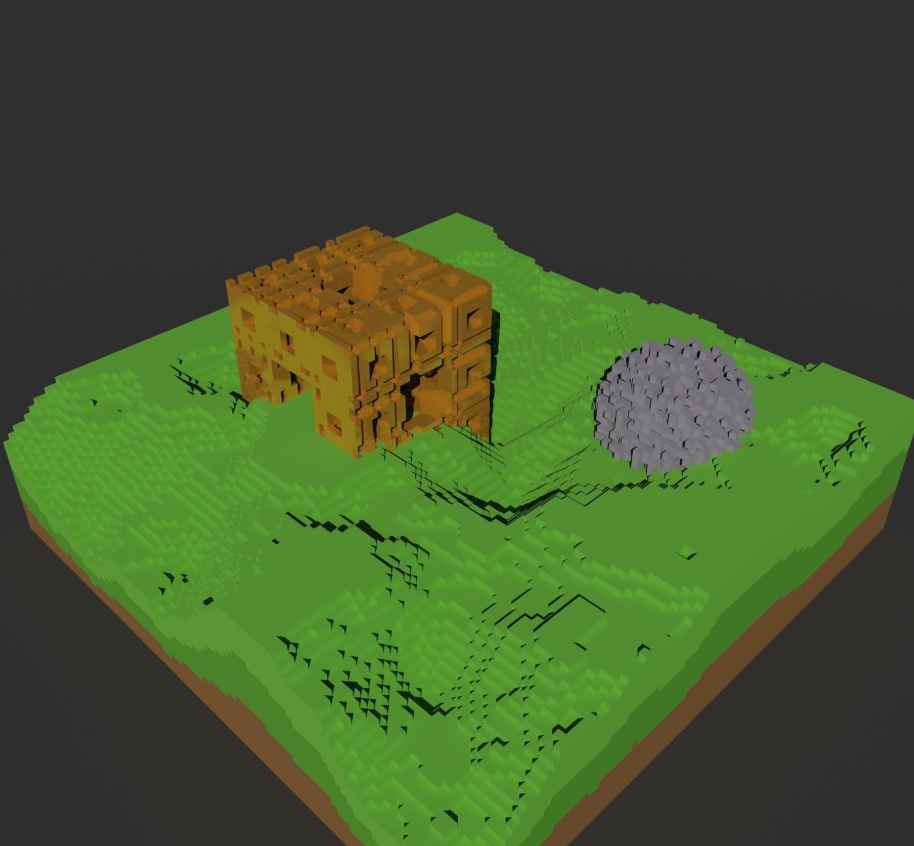
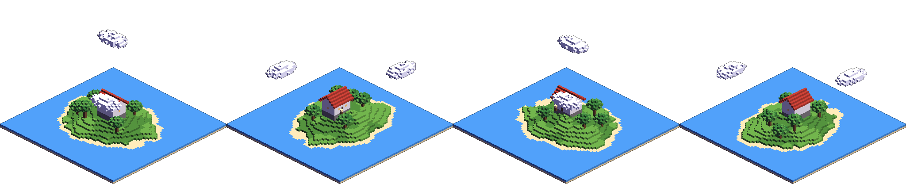

# Voxferro


A voxel editor in Rust, native on macOS (Apple silicon and Intel), Windows and Linux, compatible with the reference editor's `.vox` format.

File interoperability is a goal; the architecture is its own, in
idiomatic Rust, and does not copy the reference editor line by line.

A guide to how it works inside -- the crates, the `.vox` format, meshing,
the path tracer, the GPU kernels and the MCP server -- is in
[`docs/index.html`](docs/index.html).

## Gallery

Everything below was made and rendered with Voxferro itself: the scenes are
lists of its console commands, the images come from its path tracer.



*A small island: terrain, trees and a house with lit windows, under the
atmospheric sky, with clouds as participating media. 12,336 voxels, built
by [`island.cmds`](assets/showcase/island.cmds) (generated by
[`scripts/showcase/island.py`](scripts/showcase/island.py)); 1,024
samples.*

| | |
|---|---|
|  |  |
| *Shapes from the GPU compute kernels: a gold metal torus, a glass shell with a glowing core and a rounded box ([`shapes.cmds`](assets/showcase/shapes.cmds)).* | *A house built by Claude through the MCP server: it chose the palette, built it in `run_commands` batches and checked its own renders ([`house.vox`](assets/showcase/house.vox)).* |

| | |
|---|---|
|  |  |
| *Made by voxel scripts alone: hills from the `terrain` script in three colour bands, a gold Menger sponge from `menger`, a stone ball worn by three passes of `erode` ([`scripts.cmds`](assets/showcase/scripts.cmds)); 256 samples.* | *The island exported with `export iso`: four isometric pixel-art views, lit as the reference editor's iso export lights them.* |


*The editor with the island open, laid out as the reference editor is: palette and
brush on the left, the Edit and Project panels on the right, the console
and camera modes along the bottom.*

To rebuild a scene and render it yourself:

```bash
cargo run --release -p voxferro -- --script assets/showcase/island.cmds --render-mode
```

## Status

Phases 0–40 and 43–50 of the [ROADMAP](ROADMAP.md) are complete, with **295 tests
passing**; 41 and 42 (Windows and Linux) are prepared and built in CI, not
yet tried on real machines. Working today:

- Reading **and writing** `.vox` (versions 150 and 200), validated against the
  real corpus and against `dot_vox`
- Autosave: unsaved work is copied every two minutes, and after a crash
  the editor offers to recover it
- Viewer with greedy meshing (coplanar faces merged) in cached chunks:
  editing a 256³ model rebuilds only what was touched (~8 ms in release)
- Scene graph with transforms and animation frames; editing and rendering
  of scenes with multiple models, rotated ones included
- Open, new, save as, and a warning about unsaved changes; a Project
  panel (a folder of models opened with a click; rename, duplicate, move
  to the trash) and palette files (the reference editor's 256 × 1 PNGs)
- Attach / erase / paint brushes with voxel (1 to 64 across, cube or
  sphere, flat or solid), box, line (optionally laid on the surface),
  square, circle, face and fill shapes, with preview and one-step undo/redo per stroke; a shader
  brush (a voxel script's result, attached, erased or painted), a pattern
  brush, region rules for fills (same colour, or connected by colour or
  geometry), mirror and axis modes
- Selection (box marquee, square or circle on a layer, face, color), copy/cut/paste, move; rotate, mirror,
  crop and resize the model; move, scale, turn and wrap the selection with
  the mouse (wrap repeats it to fill a stretched box)
- the reference editor's Edit panel: full, reverse, double and halve, loop, scale,
  shear, any-angle rotation, repeat, mirror and diagonal symmetry, shapes,
  maze, Perlin noise, fractal, hull, flood, dilation and erosion, with the
  formulas of its own kernels
- Several objects at once, as the reference editor's World mode: Shift+click and
  marquee selection; union, intersection, subtraction and replacement;
  align, drop to the ground, flip; copy, copy as reference, cut and paste;
  a placement copied from one object and pasted on others (whole, only the
  rotation or only the position); Tab into a group, Shift+Tab out
- Editable scene: move, turn, duplicate, add and remove models; groups
  (create, move, turn, hide, dissolve, drag in the tree, open and close,
  sort by name; hide others, show all) and named layers with visibility
  (one layer alone, sorted by name, its objects selected), all
  saved in the file
- Palette and materials editable from the interface, with undo
- Animation: playback, transform keys (interpolated as in
  the reference editor a recent version), shape frames, range, timeline (with
  draggable keys) and export of rendered frames to PNG; stepping a frame
  or a key at a time (`,` `.`, Cmd+`,` Cmd+`.`), loops, reversed keys, and
  Global Time (off, only the open group animates)
- Export to OBJ + MTL + palette texture, and to the reference editor's other
  formats: PLY (faces, cubes or points), a smooth surface by marching
  cubes, XRAW, Qubicle QB, SLAB6, PNG
  slices and isometric or front-view pixel sprites; import of `.vox`, XRAW, QB and SLAB6 models into a scene, of OBJ
  meshes as voxels (coloured by material or palette texture), of
  another project's materials, render settings, cameras or palette, and
  *Recover* for damaged files
- Camera: frame selection or scene, axis and isometric views,
  the reference editor's four modes -- perspective, free (look around and fly with
  W A S D Q E), orthographic and isometric -- also in the path tracer and
  in saved cameras, panning, a view cube with a camera ruler (drag to turn
  in 5° steps), and snapshots of the viewport or the whole window
- Display switches: voxel edges, frame lines, grid, background objects,
  wireframe and shadows, with the reference editor's shortcuts (Cmd+E, F, G, B, M;
  in the render, Cmd+E and Cmd+G switch its own edges and grid);
  the reference editor's view options: ambient occlusion, constant shading, the
  other models faded while one is edited, the background, frame, edge and
  selection colours, the frame lines' spacing and the interface scale
  (Cmd+minus, Cmd+plus)
- Palette notes: a line of text per row, edited in the panel, saved in
  the file (or not), exported and imported as text
- Dropping a file on the window asks what to do with it: open it, add
  its models to the scene, or take it as the palette
- Exports of only the selected objects, or of each model in its own
  coordinates
- Palette tools: several colours selected, sorted by hue, saturation or
  value (the display order only), random recolouring, HSV and hex editing
- Render: transparent or coloured background, the Blend material (a lamp
  when it emits), voxels as spheres, cylinders, bricks with studs, clay or
  marching cubes, grid and edge lines drawn in the image, a turntable with
  motion blur, and a numeric camera panel with roll
- Render settings (sun, uniform / atmospheric / HDR sky, ground, lens,
  film, bloom) editable in the panel, with undo and saved in the
  file; depth of field with a polygonal aperture, focused with a click;
  stereographic and panorama lenses; the reference editor's sample options
  (diffuse, specular and scatter depths, an energy limit against
  fireflies, anti-aliasing on or off)
- Command console
- Voxel operations as compute kernels in WGSL
- Voxel scripts (`xs`): the reference editor's GLSL scripts run unchanged, and WGSL
  ones of our own, from a Scripts panel with a slider per argument
- Atomic saving that preserves materials, cameras and renderer settings
- Progressive path tracer (GI, shadows, ACES) with the file's lighting
- Metal, glass, emissive and cloud materials (media that absorb, scatter
  or emit), with the reference editor's formulas; fog
- Infinite ground plane that blends into the horizon
- Lighting with HDR maps, oriented and normalized as in the reference editor
- Atmospheric sky with Rayleigh and Mie scattering, and a sun that reddens at sunset

The backend wgpu picks is logged at startup; on an Apple M2, for example: `[voxferro] graphics backend: Metal on Apple M2`.

## Download

Packages for macOS (universal: Apple silicon and Intel), Windows and Linux are on the
[Releases](https://github.com/0xshellcode/voxferro/releases) page, with
install notes. A release is built by `.github/workflows/release.yml` when a
tag like `v0.1.0` (matching the workspace version) is pushed.

## Usage

```bash
cargo run -p voxferro                                  # opens monu1.vox
cargo run -p voxferro -- assets/vox/castle.vox         # opens another model
cargo run -p voxferro -- --run "gpu torus 166 40 14 replace" --run "save out.vox"
cargo run -p voxferro -- --run "new 40" --run "xs menger 3" --run "xs -n 2 grow" --screenshot out.bmp
cargo run -p voxferro -- assets/vox/monu1.vox --render-mode           # opens in Render mode
cargo run -p voxferro -- assets/vox/monu1.vox --render 200 --screenshot out.bmp
# A final render at its own size, saved as PNG; the editor quits when done:
cargo run --release -p voxferro -- scene.vox --run "render image 1920 1080 256 out.png"
cargo run -p voxferro -- --run "new 16" --run "brush attach box" --drag 0.3 0.7 0.6 0.8 --screenshot out.bmp
```

| Flag | What it does |
|---|---|
| `[model.vox]` | The file to open (default: the bundled `monu1.vox`, or an empty model) |
| `--run <command>` | A console line run before the first frame; repeatable, in order |
| `--script <file>` | A file of console lines, one per line (`#` comments and blank lines skipped) |
| `--screenshot <file.bmp>` | Saves the viewport (or the render) as a BMP, then quits |
| `--render <samples>` | Path traces that many samples before the screenshot |
| `--render-mode` | Opens in Render mode, interactively |
| `--camera <azimuth> <elevation>` | View direction in degrees; azimuth -90 is the front view |
| `--click <fx> <fy>` | A click at that fraction of the viewport |
| `--drag <fx0> <fy0> <fx1> <fy1>` | Press, move, release, in fractions of the viewport |
| `--mcp [port]` | Starts the MCP server (port 47800 by default) |
| `--timings` | Prints rebuild timings and each console command's duration |
| `--icon <out.png>` | Like `--screenshot`, written as the app icon |

`--make-ico` and `--make-icon-set` are packaging tooling, used by the icon
and package scripts.

To let an agent use the editor over MCP (only on `127.0.0.1`, off by
default; it can also be turned on from the *Agents (MCP)* section of the panel):

```bash
cargo run -p voxferro -- --mcp                          # listens on 127.0.0.1:47800
claude mcp add --transport http voxferro http://127.0.0.1:47800/mcp
```

| Tool | What it does |
|---|---|
| `run_command` | Runs one console line; edits go into the undo history |
| `run_commands` | Runs several lines in order as one undo step, stopping at the first failure |
| `get_palette` | Lists indices 1–255 with their colours as hex, and non-diffuse materials |
| `describe_scene` | The open document as JSON: models, instances, layers, colours in use, frame, unsaved changes |
| `set_voxels` | Sets voxels of the selected model (its own cells, z up; colour 0 erases), as one undo step |
| `open_file` | Opens a `.vox`; with unsaved changes the editor asks first |
| `save_file` | Saves as `.vox`; writing over an existing file waits for the user's permission |
| `capture_view` | The editor view as a PNG, or the path traced image after some samples |

As a macOS application, with its icon:

```bash
./scripts/bundle-macos.sh          # creates target/Voxferro.app
open target/Voxferro.app
./scripts/make-icon.sh             # re-renders the icon
```

On Windows (built and smoke-tested in CI on a software GPU; not yet tried on
a Windows machine):

```powershell
powershell -ExecutionPolicy Bypass -File scripts\package-windows.ps1 -WithDxc   # target\dist\Voxferro-<version>-windows-x64.zip
```

Render mode on DirectX 12 needs Microsoft's DXC shader compiler
(`dxcompiler.dll` and `dxil.dll` next to `voxferro.exe`; `-WithDxc` downloads
a pinned release). Without it Voxferro uses Vulkan if the GPU driver offers
it, and otherwise says that Render mode needs DXC. `dxil.dll` comes under a
Microsoft licence with distribution requirements: read `LICENSE-MS.txt`
before sharing a package that includes it.

On Linux:

```bash
./scripts/package-linux.sh                         # target/dist/voxferro-<version>-linux-<arch>.tar.gz
tar -xzf target/dist/voxferro-*-linux-*.tar.gz -C ~/.local
```

The tarball holds `bin/` and `share/` (the `.desktop` entry, icons, the
`.vox` MIME type and the assets); with `appimagetool` on the `PATH` the
script also builds an AppImage. File dialogs use the XDG desktop portal;
without one, `open <path>` in the console always works.

**Mouse:** clicking on the model edits with the brush; clicking on empty space
(or dragging with the right button) orbits; Shift + drag or the middle
button pans; the scroll wheel zooms in.

**Option+Shift+click** on a model selects its group (again: one level further
in).

**Move tool:** dragging moves the model (or its selected group) along
the ground; Shift+drag, up and down; Cmd+drag turns around z;
X, Y, Z give a quarter turn.

**Keyboard,** the reference editor's (its `hotkey.txt`): V F B L C P brush shape
(voxel, face, box, line, shader, pattern), T R G mode (attach, erase,
paint), M marquee and N region select, 1 2 3 mirror and Cmd+1 2 3 axis on
x, y, z, U full, I fill,
Alt+click takes a voxel's colour, 5 frames (Shift+F everything), 6
snapshot, 7 and 8 save and load the camera slot, comma and period step
the animation's frames, F5 and F6 add and remove a key. The editor's own:
Alt+1–7 fixed views, O orthographic, - and + brush size, W A S D Q E fly (free camera);
Cmd+E/F/G/B/M display switches (Shadow has none: Cmd+W closes the window);
Cmd+N/O/S, Cmd+Shift+S, Cmd+Z / Cmd+Shift+Z or Cmd+Y; with a selection,
Cmd+A, Esc or Cmd+D to deselect, Delete, Cmd+C/X/V, arrow keys and Page Up/Page Down to move it;
Enter keeps and Esc drops a pending mouse transform.

**Console** (along the bottom; `help` lists the commands):

| Group | Commands |
|---|---|
| History | `undo`, `redo` |
| Files | `open [path]`, `new [n \| x y z]`, `save [path]`, `recover <path>`, `export [obj\|ply\|mc\|cube\|point\|xraw\|qb\|slab\|slice\|iso\|2d] <path>`, `import <path>`, `import <file.obj> [size] [fill]`, `import materials\|render\|cameras\|palette\|notes <file.vox\|file.txt>`, `export materials\|render\|cameras\|notes <file.txt>`, `export selected\|local [on\|off]`, `note <row> [text]\|clear\|save on\|off`, `autosave [on\|off\|<minutes>\|recover\|discard]` |
| Project | `project [list \| dir <path> \| open <name> \| rename <name> \| dup \| delete]` |
| Brush | `brush [attach\|erase\|paint\|select\|move] [voxel\|box\|line\|square\|circle\|face\|fill\|shader\|pattern]`, `brush size <1-64>`, `brush tip cube\|sphere\|2d\|3d`, `brush centre fill\|ring\|even\|odd`, `brush project on\|off`, `brush face color\|geo\|4\|8\|palette\|voxel`, `brush mirror\|axis <axes>`, `brush region same\|color\|geo [4\|8]`, `brush pick` (eyedropper), `color <n>` |
| Pattern | `pattern selection\|open <file.vox>\|match on\|off\|turn x\|y\|z\|colours own\|brush\|clear` |
| Selection | `select all\|none\|invert\|color [n]`, `delete`, `paint [c]`, `copy`, `cut`, `paste`, `move dx dy dz`, `transform scale <axes> <f>`, `transform rotate <axis> <deg>`, `transform wrap <x\|-x\|y\|-y\|z\|-z> <cells> [two]`, `transform spacing <x> <y> <z>`, `transform drag move\|scale\|turn\|wrap\|off`, `transform keep\|drop` |
| Model | `rotate x\|y\|z` (or `rot90`), `mirror x\|y\|z` (or `flip`), `crop` (or `shrink`), `resize x y z`, `fill`, `clear`, `box`, `sphere`, `voxels x y z c …`, `gpu …` |
| Scene | `instance list\|select i\|move dx dy dz\|place x y z\|turn\|dup\|delete\|new [x y z]` |
| Objects | `object all\|none\|invert\|add i\|remove i\|list`, `object move dx dy dz\|turn x\|y\|z\|delete`, `object align x\|y\|z -1\|0\|+1`, `object ground`, `object flip <axes>`, `object union\|intersect\|operand\|subtract\|replace`, `object copy [ref]\|cut\|paste\|own`, `object transform copy\|paste [rot\|pos]\|reset`, `object level in\|out` (Tab, Shift+Tab) |
| Palette | `palette open\|save <file.png>`, `palette reset`, `palette default 0-3`, `palette swap\|gradient\|copy <a> <b>`, `palette paste <i>`, `palette <i> <r> <g> <b>`, `palette select all\|none\|invert\|used\|unused`, `palette sort <keys>`, `palette rand`, `palette set\|fill <colour>`, `palette adjust h\|s\|v\|r\|g\|b <n>`, `palette copy\|paste`, `material <i> <diffuse\|metal\|glass\|emit\|cloud\|blend> [key=value]…` |
| Groups and layers | `group [i ...]\|select n`, `ungroup`, `node name\|hide\|show\|move\|turn\|into`, `tree sort\|expand [all]\|close [inactive]\|hide [deep\|others]\|show [deep\|all]\|toggle`, `layer list\|new\|hide\|show\|toggle\|name\|assign\|current n\|only [n]\|all\|sort\|select [n]` |
| Animation | `anim play\|stop\|frame n\|fps n\|key\|unkey\|newframe\|movekey a b\|moveframe a b\|range a b\|export dir [samples]`, `anim step <n>`, `anim key next\|prev\|first\|last`, `anim loop on\|off`, `anim reverse`, `anim global [on\|off]` |
| Camera | `camera front\|back\|left\|right\|top\|bottom\|iso\|ortho\|persp\|free\|frame [all\|selection\|group\|instance]` (`orth`, `pers` also), `camera zoom <f>\|slots\|save <0-9>\|load <0-9>`, `snap [file.png]`, `snap window [file.png]`, `render save <file.png>`, `render image <w> <h> <samples> <file.png>\|cancel`, `render spin <frames> <degrees> <blur %> <w> <h> <samples> <file.png>`, `camera set x\|y\|z\|pitch\|yaw\|roll\|zoom\|fov\|mouse\|keys <v>` |
| View | `view [edges\|frame\|grid\|bg\|wire\|shadow] [on\|off]`, `view cube [on\|off]`, `view ruler [on\|off]`, `view ao\|flat\|fade [on\|off]`, `view colour bg\|grid\|edge\|select <colour>`, `view spacing <n>`, `view scale <f>\|inc\|dec` |
| Edit | `full`, `zero`, `rev`, `x2`, `xh`, `loop <axis> <n>`, `scale <axes> <f>`, `shear <axis> <a> <b>`, `rot <axis> <deg>`, `repeat <axes> <n>`, `mir <axis>`, `dia <axis>`, `prim elli\|cyli\|pyra\|cone`, `flood [c]`, `hull`, `dil\|ero [6\|18\|26]`, `mask`, `tex`, `maze [p]`, `noise [seed] [scale] [lo] [hi]`, `fractal` |
| Scripts | `xs [-n passes] [-c c1,c2,…] <script> [args…]`, `xs list`, `xs use <script> [args…]` |
| Render | `env uniform\|atmosphere [elev]\|ibl <map> [i] [rot]\|dof [on\|off]\|lens [aperture] [blades] [angle]\|bloom [mix] [scale] [aspect] [threshold]\|vig <v>\|background sky\|none\|<colour>\|shape cube\|sphere\|cylinder\|brick\|clay\|mc [size]`, `env grid on\|off [width] [spacing] [ground]`, `env edge on\|off [width]`, `env grid\|edge colour <colour>`, `env bounce <diffuse> [specular] [scatter]`, `env energy <1-5000>`, `env aa [on\|off]`, `env proj perspective\|sg\|panorama [fov]`, `env focus <depth>\|auto` |

For testing without a mouse: `--click fx fy` and `--drag fx0 fy0 fx1 fy1`, in
fractions of the viewport (see the flags above).

## Stack

| Piece | Choice | Why |
|---|---|---|
| Window + UI | `eframe` / `egui` 0.36 | Brings wgpu by default and pins a stable `winit` |
| Graphics | `wgpu` 30 | Emits **native Metal** on Apple Silicon |
| Math | `glam` 0.34 | SIMD, the ecosystem standard |
| GPU bytes | `bytemuck` 1 | `#[derive(Pod)]` for the buffers |
| Dialogs | `rfd` 0.17 | Native open and save panels |
| PNG | `miniz_oxide` 0.9 | DEFLATE for the exported frames |
| Icons | `egui-phosphor` 0.14 | Phosphor's icons, built for egui 0.36 |
| MCP | `rmcp` 3.5 | The official Rust MCP SDK, for the agent server |

`eframe` and `wgpu` resolve to a **single** `wgpu v30.0.1` in the graph. If
two versions show up, the types stop being assignable to each other and the
errors become incomprehensible: check with `cargo tree | grep wgpu`
before touching those versions.

## Structure

```
crates/
├── vox-format/   .vox parser          — no graphics dependencies
├── voxel-core/   volume, graph, undo, brushes, selection, meshing, OBJ
│                 — no graphics dependencies
└── app/          eframe + egui + wgpu
```

The first two crates deliberately do not depend on wgpu: `cargo test -p
vox-format` runs in a second instead of recompiling the graphics stack.

### Tests

```bash
cargo test -p vox-format -p voxel-core   # fast: does not compile wgpu
cargo test                               # everything
```

## License and scope

Independent implementation. The `.vox` format is publicly documented
by its author, its author. This repository contains no the reference editor code or
assets; the test models are kept out of version control
(see `assets/README.md`).

## License

Dual-licensed, at the user's option: [MIT](LICENSE-MIT) or
[Apache 2.0](LICENSE-APACHE).

the reference editor is the work of its author. Voxferro is not affiliated with the reference editor and
does not contain its code: it reads and writes its `.vox` format. The example models and
the reference editor's environment maps are not included in the repository (see
[assets/README.md](assets/README.md)).
